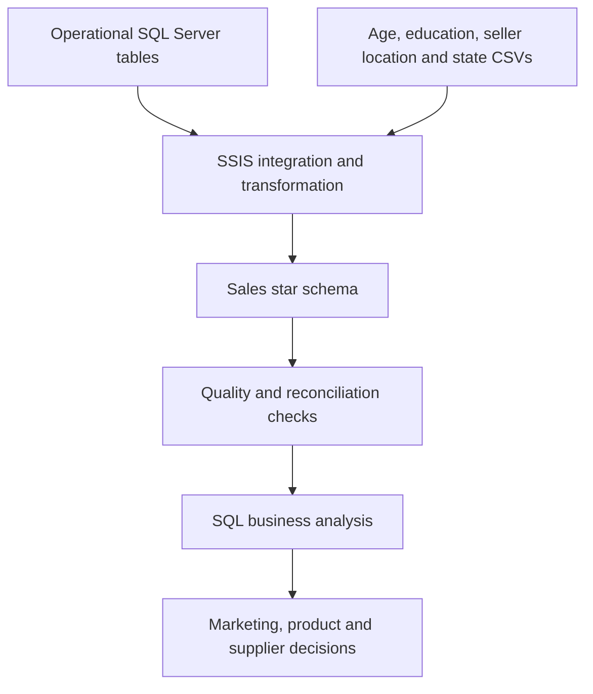
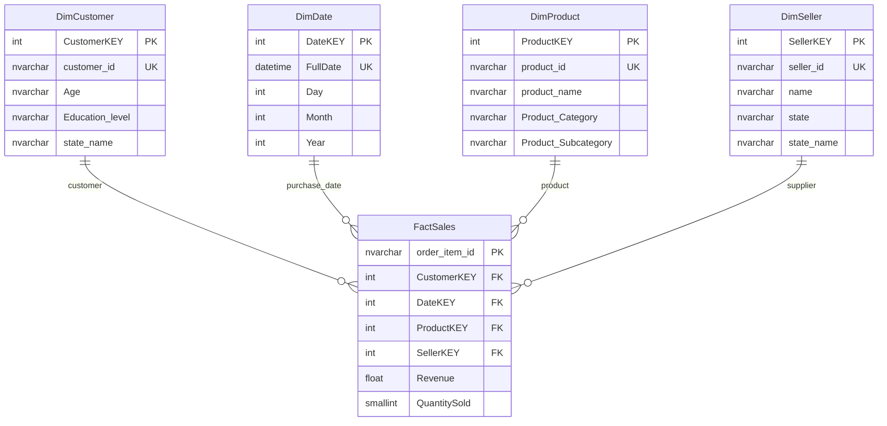

# OzMart Retail Data Warehouse

**SQL Server · SSIS · Dimensional Modelling · SQL Analytics · Data Quality**

A retail analytics project that integrates order transactions and reference files into a sales data warehouse. It demonstrates how to define an analytical grain, build a star schema, implement visual ETL, and turn sales data into regional customer, product and supplier decisions.

Developed from the University of Queensland BISM7233 OzMart case. The original SSIS implementation and report are preserved alongside a documented SQL reconstruction and a small, executable portfolio demo.

The original fact-flow screenshot records **137,901 order lines** through a pipeline with **four dimensions and five SSIS data flows**. The portable demo adds six executable analytical queries and 13 behavioural tests on clearly labelled synthetic data.

**[Architecture](docs/architecture/data-model.md) · [SSIS implementation](docs/architecture/etl.md) · [Business analysis](docs/analytics/business-questions.md) · [Run the project](docs/setup.md) · [繁體中文](README.zh-TW.md)**

## What this project demonstrates

| Capability | Implementation | Evidence |
| --- | --- | --- |
| Translate business needs into a warehouse | Kimball's four steps; one order line per fact row; four denormalised dimensions | [Model and grain](docs/architecture/data-model.md) |
| Build a SQL data warehouse | Table definitions, identity surrogate keys, primary/foreign keys, unique business keys and query indexes | [SQL Server DDL](sql/setup/01_create_warehouse.sql) |
| Integrate heterogeneous data | SQL Server sources plus CSV reference files; SSIS Sort, Merge Join, Lookup, Derived Column and Aggregate | [Five SSIS data flows](docs/architecture/etl.md) |
| Handle source quality problems | Detect non-unique seller locations and retain uncertainty as `Unknown` | [Quality case](docs/data-quality.md) |
| Analyse retail performance | CTEs, joins, aggregation, partitioned ranking and window calculations | [Six analytical SQL files](sql/analytics) |
| Make analysis reviewable | Source inventory, screenshots, data dictionary, reconciliation queries and a tested synthetic demo | [Evidence and validation](docs/evidence/README.md) |

## Business problem

OzMart's operational database supports orders but makes cross-table reporting difficult. Management needs to know which customer ages generate revenue in each state, which product types sell most in each state, and which suppliers located in New South Wales sell the most units each year.

The warehouse separates measurable sales events from descriptive context so the same facts can answer all three questions consistently.



## Warehouse design

**Grain: one source `order_item_id` per `FactSales` row.** `QuantitySold` can exceed one; a fact row is an order line, not necessarily a single physical unit.



The diagram shows the implemented analytical fields; the [dictionary](docs/data-dictionary.md) also documents product description and category identifiers. SQL definitions were reconstructed from SSIS destination metadata, with additional constraints; they are not an exported original database schema.

## From SQL to a business decision

| Question | Analytical technique | Decision it supports |
| --- | --- | --- |
| Highest-revenue customer age in each state | Aggregate revenue, then `ROW_NUMBER()` per state | Choose demographic segments for further marketing tests |
| Top five product types in each state | Aggregate units by category/subcategory, rank within state | Prioritise regional assortment and campaigns |
| Top five NSW suppliers in each year | Filter **seller state**, aggregate units by stable supplier ID, rank per year | Review supplier relationships and capacity |
| Monthly state performance | Aggregate by year/month/state | Investigate seasonality and regional demand |
| Supplier concentration in NSW | Window totals and cumulative unit share | Identify dependence on a small number of suppliers |
| Age-segment revenue share | Revenue share, units and order-line counts | Put the winning age in context before allocating budget |

Revenue is the source order-line total. It is **not profit**, and no conversion-rate or marketing-ROI claim is made. The supplier query measures suppliers based in NSW, not sales delivered to NSW. See [metric definitions and interpretation](docs/analytics/business-questions.md).

## Review the original implementation


The [original report](docs/evidence/ozmart-original-report.pdf) contains historical screenshots of dimension loads, the fact load and the three original query outputs. These images are original evidence, not a fresh execution in this repository. The [editable report](docs/evidence/ozmart-original-report.docx), [source ERD](docs/assets/source-erd.png), [case brief](docs/reference/case-brief.pdf) and [source dictionary](docs/reference/source-data-dictionary.md) are also included.

The saved package has all four dimension tasks disabled and the fact task enabled. Its dimension-to-fact success constraints remain present. A clean run requires configuring connections, pointing to the included reference CSVs and enabling the dimension tasks. The [setup guide](docs/setup.md) gives the complete sequence.

## Run a small demo on any platform

Requires Python 3.10+ and its standard library; no SQL Server, cloud account or Python packages required.

```bash
git clone https://github.com/1121eason/UQxOzMart-DataWarehouse.git
cd UQxOzMart-DataWarehouse
python scripts/run_demo.py
python -m unittest discover -s tests -v
python scripts/verify_repository.py
```

The demo loads clearly labelled synthetic CSV fixtures into SQLite, resolves dimension keys, checks order-line uniqueness and foreign keys, runs the **same six analytical SQL files**, and exports CSV results to `demo/output/`. It is a portable demonstration of the model and query logic; it does not execute or replace the original SSIS package.

Sample output files are committed under [demo/expected](demo/expected). The fixtures include revenue ties, suppliers sharing a display name, two years and an ambiguous location to exercise the important edge cases.

## Run the SQL Server and SSIS path

1. Read [setup and prerequisites](docs/setup.md). The supplied project targets **SQL Server 2025**.
2. Decompress and inspect the [source backup](data/source); restore it as `ozmart_db` in your own SQL Server instance.
3. Configure the four included reference CSV files listed in [data/reference](data/reference).
4. Run [warehouse DDL](sql/setup/01_create_warehouse.sql) in SSMS, then open [Assignment1.dtproj](ssis/Assignment1/Assignment1.dtproj) in Visual Studio with SSIS Projects.
5. Configure local connections, enable all four dimensions, and execute against a fresh warehouse before loading facts.
6. Run [warehouse checks](sql/validation/01_warehouse_checks.sql), [source reconciliation](sql/validation/02_source_reconciliation.sql), and the [analytics](sql/analytics).

**Current reproducibility:** the portable demo is executable, and the source backup, all four reference CSVs, source ERD and data dictionary are included. The 112 MB attachment is a **source database backup**, not a completed warehouse backup; a gzip copy is included. SQL Server/SSIS still requires compatible local tooling and connection configuration. No fresh SQL Server restore, SSDT build or SSIS execution is claimed.

## Repository map

| Path | Contents |
| --- | --- |
| `ssis/Assignment1/` | Canonical version 101 SSIS package and project, with stored credentials removed |
| `sql/setup/` | Reconstructed warehouse DDL and indexes |
| `sql/analytics/` | Three core business queries and three portfolio extensions |
| `sql/validation/` | Warehouse quality checks and source-to-fact reconciliation |
| `docs/` | Design rationale, ETL mappings, dictionary, business interpretation and setup |
| `docs/assets/` | Original model, SSIS and query-output images |
| `docs/evidence/` | Original report, input inventory and provenance |
| `demo/`, `scripts/`, `tests/` | Synthetic fixtures, portable ETL, CSV outputs and regression tests |
| `data/source/` | Compressed supplied source backup and checksum |
| `archive/ssis-v99/` | Sanitised earlier package variant |

## Scope and next improvements

This is an academic retail warehouse prototype prepared as a technical portfolio. Historical execution evidence and newly added demo validation are distinguished in [validation status](docs/validation.md). Incremental loading, SCD Type 2, production scheduling and a BI dashboard are future work. Monetary `float` is retained for compatibility with the original SSIS metadata; a production migration should use fixed-precision decimals throughout ingestion and storage.

**Author:** Yi Cheng Lee (Eason) · University of Queensland. Repository organisation, SQL refinements, documentation and the synthetic demo were prepared with AI assistance; the original report and SSIS evidence are retained for comparison. See [provenance](docs/evidence/README.md) and [usage notes](NOTICE.md).
