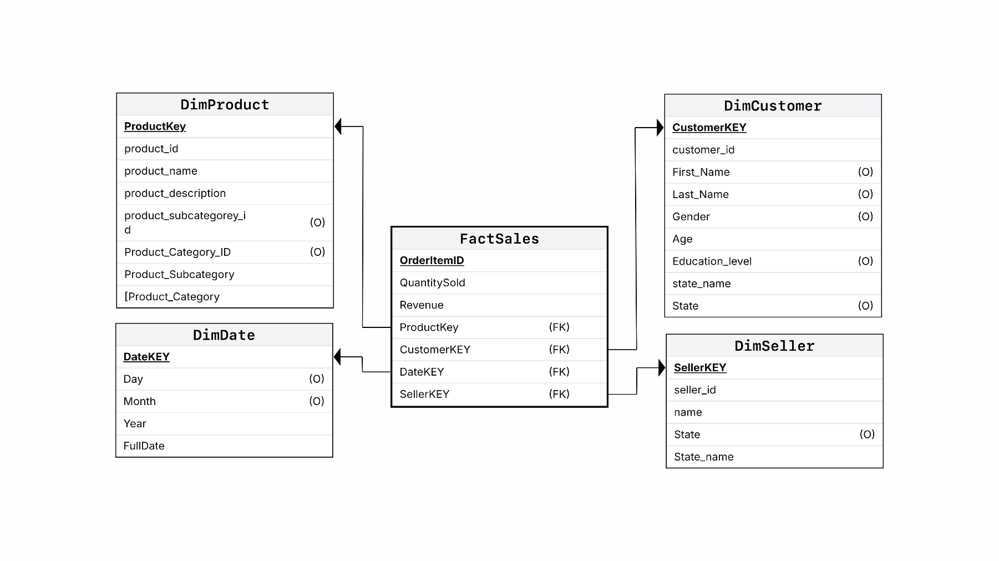
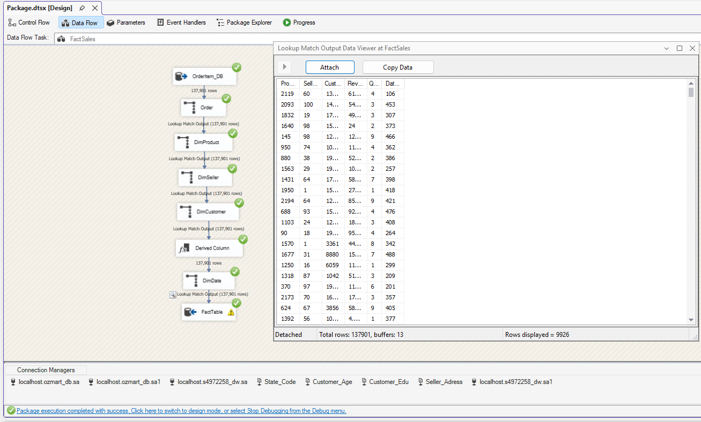

# OzMart 零售資料倉儲

**SQL Server · SSIS · 維度模型 · ETL · SQL 資料分析 · 資料品質**

本專案將 OzMart 的交易資料庫與 CSV 參考資料整合為銷售資料倉儲，展示從商業問題、資料粒度、星狀模型到 ETL 與分析查詢的完整設計。源自昆士蘭大學 BISM7233 個案，原始報告與 SSIS 成果保留在儲存庫中，並另外提供可執行的合成資料展示。

[English](README.md) · [模型設計](docs/architecture/data-model.md) · [ETL 流程](docs/architecture/etl.md) · [分析問題](docs/analytics/business-questions.md) · [執行方式](docs/setup.md)

## 核心能力

| 能力 | 本專案如何呈現 |
| --- | --- |
| 建立 Data Warehouse | 使用 Kimball 四步驟界定銷售流程、訂單明細粒度、維度與衡量值 |
| 維度模型設計 | `FactSales` 搭配客戶、日期、商品、賣家四個維度，使用代理鍵連結 |
| 整合異質來源 | SSIS 整合 SQL Server 資料表與年齡、教育、賣家位置、州別 CSV |
| ETL 與資料轉換 | Sort、Merge Join、Lookup、Derived Column、Aggregate、Conditional Split |
| 資料品質判斷 | 發現同一位置代碼對應 TAS 與 WA，保留 Unknown，避免任意歸屬 |
| Data Analytics | CTE、分組彙總、視窗函數與排名，分析客群、商品及供應商 |
| 可檢查的技術交付 | 原始截圖、來源清單、資料字典、核對查詢與合成資料測試 |

## 資料模型

每筆事實資料對應一個來源 `order_item_id`。一筆訂單明細可以包含多件商品，因此資料筆數與銷售件數不同。`Revenue` 直接取自 `line_total`，`QuantitySold` 取自 `item_quantity`。



客戶州別用於分析區域需求，賣家州別用於分析供應商所在地。兩者在查詢中有不同意義。報告中的部分客戶欄位為選填設計；實作欄位以 SSIS destination metadata 與[資料字典](docs/data-dictionary.md)為準。

## 從資料到分析

三個原始問題分別為：各州營收最高的客戶年齡、各州銷售量前五名商品類型，以及每年位於 NSW 的前五大供應商。這次整理另補上月度州別銷售、供應商集中度及年齡營收占比。

查詢保留清楚的衡量定義。營收不等於利潤，訂單明細數不等於訂單數。NSW 供應商分析依賣家所在地篩選，也會包含他們賣給其他州客戶的商品。



原報告截圖顯示 137,901 筆資料通過事實表查找流程，並有當時的執行成功訊息。這是歷史成果證據。本次未重新執行 SQL Server restore、Visual Studio build 或 SSIS。

## 直接執行展示

需要 Python 3.10 以上及支援視窗函數的 SQLite，不需安裝第三方套件。

```bash
git clone https://github.com/1121eason/UQxOzMart-DataWarehouse.git
cd UQxOzMart-DataWarehouse
python scripts/verify_repository.py
python scripts/run_demo.py
python -m unittest discover -s tests -v
```

展示會建立合成資料倉儲，直接執行六份分析 SQL，並輸出 CSV。控制總數為 **13 筆訂單明細、43 件商品、1,680.00 營收**。這些合成數字與原 OzMart 資料、原報告結果分開標示。

## 專案內容

| 路徑 | 內容 |
| --- | --- |
| `ssis/Assignment1/` | build 101 的 SSIS 原始碼，已移除儲存憑證 |
| `sql/` | 重建的資料表 DDL、原始與改良分析查詢、資料核對查詢 |
| `docs/` | 模型與 ETL 說明、分析定義、原始報告、截圖與參考資料 |
| `data/` | 四份原始 CSV，以及無損壓縮的來源資料庫備份 |
| `demo/`、`scripts/`、`tests/` | 合成資料、可執行展示與驗證 |
| `archive/ssis-v99/` | 經去除憑證處理的較早 ISPAC 版本 |

17 份提供的檔案均列於[來源清單](docs/evidence/input-inventory.json)。使用者個別的 `.dtproj.user` 不上傳。資料庫附件是來源備份，並非已完成的資料倉儲備份；來源 `.database` 則是專案 XML metadata。

SSIS 專案目標為 SQLServer2025。四個維度 task 在原檔中儲存為停用，須先設定連線、啟用維度，再依[操作說明](docs/setup.md)載入全新倉儲。此原型尚無增量載入、SCD Type 2、生產排程或 BI 儀表板。

作者 Yi Cheng Lee（Eason）。本次作品集整理、SQL 補充、文件與合成展示使用 AI 協助；原作業成果與新增內容的範圍列於[來源說明](docs/evidence/README.md)及[使用註記](NOTICE.md)。
