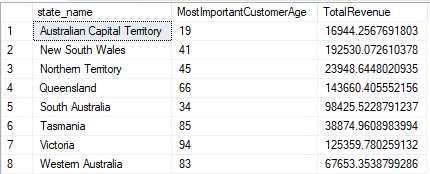

# Retail analysis and interpretation

The three core questions use the same order-line fact and four dimensions. Geography and the measure being ranked determine what each result means.

| Question | Metric and grouping | SQL |
| --- | --- | --- |
| Which customer age contributes most revenue in each state | Sum of line revenue by customer state and age; one winner per state | [Customer age](../../sql/analytics/01_top_customer_age_by_state.sql) |
| Which five product types sell the most in each state | Sum of units by customer state, category and subcategory | [Product types](../../sql/analytics/02_top_product_types_by_state.sql) |
| Which five NSW suppliers sell the most each year | Sum of units by purchase year and seller ID, filtered on seller state | [NSW suppliers](../../sql/analytics/03_top_nsw_suppliers_by_year.sql) |

Each query aggregates in a CTE, applies `ROW_NUMBER()` within the relevant state or year, then filters the rank. The portfolio versions add stable tie-breakers. The supplier query also groups by `seller_id` so suppliers sharing a name remain separate. The [original report SQL](../../sql/original/) is retained for comparison; these refinements are not attributed to the original submission.

`ROW_NUMBER()` returns at most one or five rows as requested. It does not return every tied winner. Use a deliberately defined `DENSE_RANK()` policy if the business wants all ties. Customer age is text in the original schema, so the age tie-break converts numeric ages; review the age quality check before running it against a newly loaded warehouse.

## Historical examples

The report's customer query shows age **41** as the highest-revenue age in New South Wales, with approximately **192,530.07** line revenue, and age **66** in Queensland with approximately **143,660.41**. These are historical query-output values, not new measurements. Revenue alone does not establish customer profitability or a causal marketing opportunity.

The product output shows Toys & Games / Hobbies leading Victoria at **13,760 units**. The supplier output lists Kenneth Vaughn at **4,218 units in 2022**. These examples illustrate how the model supports regional assortment and supplier-capacity review. The original supplier SQL grouped on display name, so historical supplier results may combine namesakes if the underlying source contains them.

[Product output part 1](../assets/result-product-types-part-1.png) · [Product output part 2](../assets/result-product-types-part-2.png) · [Supplier output](../assets/result-nsw-suppliers.png)

## Portfolio analysis extensions

| Analysis | What it adds | Interpretation |
| --- | --- | --- |
| [Monthly state sales](../../sql/analytics/04_monthly_state_sales.sql) | Revenue, units and order-line counts by year and month | Compare regional demand and investigate seasonality |
| [NSW supplier concentration](../../sql/analytics/05_nsw_supplier_concentration.sql) | Unit share and cumulative share within each year | Assess dependence on individual suppliers |
| [Age revenue share](../../sql/analytics/06_customer_age_revenue_share.sql) | Revenue share, units and line count for every state-age segment | Put a winning age into the context of its state |

These extensions execute in the synthetic demo. Their CSV results describe only the labelled fixtures. They have not been rerun against the supplied SQL Server backup.

## Decisions and limits

The outputs can guide questions about regional product assortment, demographic campaigns and supplier capacity. They cannot establish marketing ROI, conversion, retention or profit: the implemented target lacks the necessary cost, campaign, exposure and lifecycle data. The package's unfiltered order-status population also needs a defined sales policy before using it for financial reporting.

Seller state and customer state must remain separate in analysis. A supplier based in NSW can sell to customers in Queensland. The NSW supplier queries intentionally count those sales because the question concerns the supplier's location.
