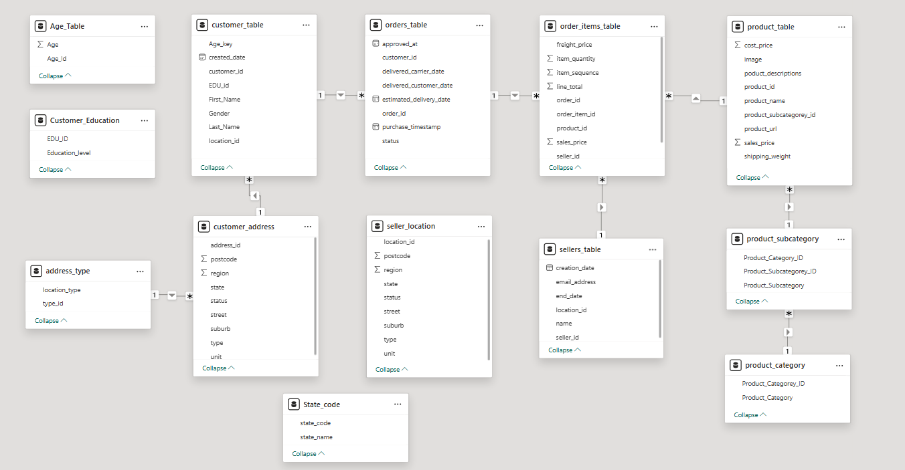

# Sales warehouse design

The warehouse uses Kimball's four design steps to turn OzMart's operational sales data into a star schema. The business process is an order-line sale. The grain is one `order_item_id` per `FactSales` row. Customer, purchase date, product and seller describe that event. Revenue and quantity are its measures.

## Source and target

The operational model distributes sales context across orders, order items, customers, addresses, sellers, products and product classifications. Age, education, seller location and state reference data arrive as CSV files.

The target consolidates descriptive hierarchies into four dimensions. Geography is retained in customer and seller dimensions because those states answer different questions. A customer-state filter describes demand by customer location. A seller-state filter describes supplier location.

## Grain and keys

`order_item_id` is the source identifier of a line within an order and serves as the fact's primary key. A line can contain several units. Counting fact rows therefore measures order lines, while `SUM(QuantitySold)` measures units. An `order_id` is not stored in the implemented target, so a distinct-order count cannot be recovered from the fact alone.

Each dimension receives an integer surrogate key. Natural IDs (`customer_id`, `product_id`, `seller_id`) remain available for lookups and reconciliation. The date dimension maps a purchase timestamp to its calendar date at midnight, which avoids creating a separate dimension row for each time of day. It contains observed purchase dates rather than a complete calendar.

The [reconstructed SQL Server schema](../../sql/setup/01_create_warehouse.sql) adds uniqueness constraints on those natural keys and dates, foreign keys from the fact and supporting indexes. These constraints are portfolio additions. The package metadata alone cannot establish the original database's constraints, indexes, nullability or identity settings.

## Measures

| Measure | Source mapping | Aggregation and interpretation |
| --- | --- | --- |
| `Revenue` | `order_items_table.line_total` | Additive across lines and dimensions; order-line revenue, with no profit calculation |
| `QuantitySold` | `order_items_table.item_quantity` | Additive number of units, including the source's sign conventions |
| Order lines | `COUNT(*)` on the fact | Number of lines, not units, customers or orders |

The original pipeline does not filter order status. Its revenue represents the loaded order-line population rather than a separately defined completed-sales or recognised-revenue population. Freight is not mapped as a separate fact measure. The target does not carry product cost, so profitability cannot be calculated from this warehouse alone.

## Proposed model and implemented fields

The report's proposed diagram includes optional names, gender and customer state code. The actual `DimCustomer` destination has only `CustomerKEY`, `customer_id`, `Age`, `Education_level` and `state_name`. The warehouse dictionary and reconstructed DDL follow that implemented subset. The original diagram labels the fact ID `OrderItemID`; the package destination uses `order_item_id`.

The package retains the source spellings `poduct_descriptions` and `product_subcategorey_id`. Keeping them in the compatibility schema avoids silently breaking destination mappings. A future migration should rename them consistently across source contracts, package metadata and queries.

The target is a full-load prototype. It has no change-history columns, incremental watermark or SCD Type 2 implementation. Those capabilities would require a new loading and history design.
