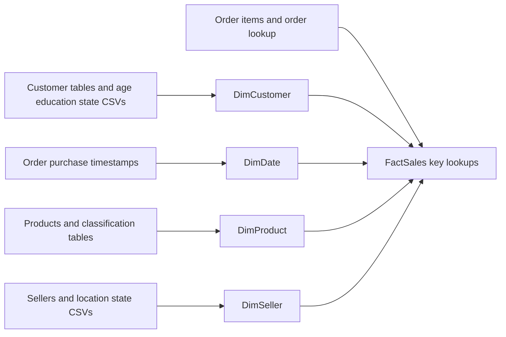

# SSIS integration and transformation

The canonical [SSIS project](../../ssis/Assignment1/Assignment1.dtproj) contains five data flows. Its loose `Package.dtsx` has `VersionBuild=101`. The supplied ISPAC contains build 99 and is preserved separately in the [archive](../../archive/ssis-v99/README.md).

## Dimension flows

| Target | Sources | Main SSIS work | Target attributes |
| --- | --- | --- | --- |
| `DimCustomer` | Customer and customer-address tables; age, education, state CSVs | Sort by join keys; standardise education IDs; merge descriptive reference streams | Customer ID, age, education and full state name |
| `DimDate` | Orders | Derive day, month, year and date-only `FullDate`; Sort with duplicate elimination | One row per observed purchase date |
| `DimProduct` | Products, subcategories, categories | Lookup subcategory, then category; flatten hierarchy | Product identifiers, description and classification |
| `DimSeller` | Sellers; seller-location and state CSVs | Sort, Multicast, Aggregate, Merge Join and Conditional Split to isolate ambiguous locations; derive fallback state | Seller ID, name and location state |

The education expression converts values such as `EDU_01` to `Edu_1` with trimming, suffix extraction and integer conversion. This is key standardisation for a reference join, not an education-level calculation.

The seller flow counts location occurrences after the initial deduplication step. `Row_Count == 1` enters the clean branch. Multiple-location keys are withheld from that branch so a seller does not acquire a state from an arbitrary matching row. After joining sellers back to the clean locations, the expression `ISNULL(state) ? "Unknown" : state` marks unresolved short state codes. See the [quality case](../data-quality.md) for the full-state-name limitation.

## Fact flow

The source is `order_items_table`. An order lookup supplies the customer and purchase timestamp. Product, seller and customer lookups resolve the three surrogate keys. Derived columns map `line_total` to `Revenue`, `item_quantity` to `QuantitySold`, and the purchase timestamp to a date-only value. The date lookup resolves `DateKEY` before the ADO.NET destination loads `FactSales`.

The historical screenshot shows 137,901 rows through the lookup path and a package execution success message. Warning icons are also visible. The screenshot records that historical run; it is not a fresh package execution or a guarantee that every warning has been resolved.

## Load order and restart behaviour

Four success precedence constraints link the dimensions to the fact task with logical AND. All four dimensions are saved with `Disabled=True`; `FactSales` is enabled. For a fresh warehouse, configure the sources, enable the dimension tasks and review those constraints before execution.

Destinations append rows. There is no truncate, upsert, delete, checkpoint recovery or watermark mechanism. Repeating a load against the reconstructed schema will encounter duplicate-key constraints. Use a fresh target for a full demonstration, or design and review a reload strategy before changing existing data.

Lookup paths connect matched outputs. A complete reject-handling and error-audit pipeline is not present. Check unmatched keys and source-to-target totals before treating a run as a complete load.

## Historical flow images

| Flow | Original screenshot |
| --- | --- |
| Date | [Date derivation and deduplication](../assets/etl-dim-date.png) |
| Customer | [Reference joins](../assets/etl-dim-customer.png) |
| Product | [Classification lookups](../assets/etl-dim-product.png) |
| Seller | [Ambiguity detection and fallback](../assets/etl-dim-seller.png) |

The public source uses `DontSaveSensitive`. Four database connection password elements and the project password verifier were removed. Local CSV paths, connection authentication and the target catalogue were made portable. Data-flow components, mappings, task states and precedence constraints were retained.
