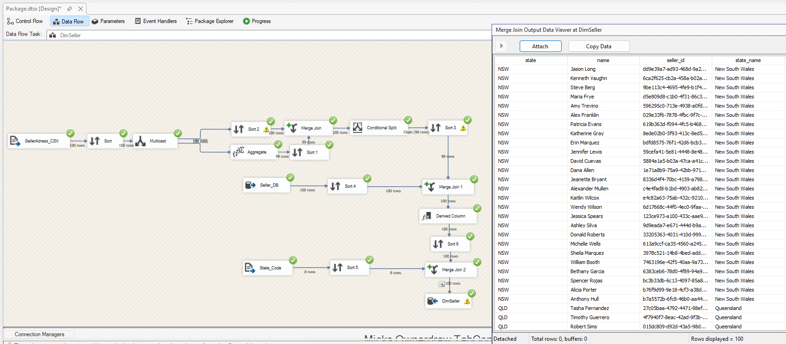

# Seller location quality case

The supplied `seller_location.csv` contains **100 rows and 99 distinct location IDs**. The ID `ece22fa5b9e06f5b` appears twice, once with state `TAS` and once with state `WA`. A normal lookup on location ID cannot choose one correct state from those records.

Assigning the first state would make regional supplier analysis depend on row order. The original SSIS flow instead counts locations, retains the unambiguous branch, joins sellers back to it, and substitutes `Unknown` when a short state is absent. The original report states that two seller records received this fallback. The raw location CSV confirms the conflicting location records; the count of affected sellers comes from the report rather than a fresh database query.

## What is preserved and what requires review

The fallback prevents an unsupported geographic assignment. It also keeps those sellers out of an NSW-only supplier query until their location is resolved. Unknown geography therefore needs a count and a review path alongside regional reporting.

Only the package's short `state` expression explicitly supplies `Unknown`. The full `state_name` is then obtained through the eight-row state-code reference, which has no `Unknown` row. The saved final join can leave that name null. The portfolio demo makes both fields explicitly `Unknown` for clarity. It does not claim that this was the original target's stored value.

The original rule uses location occurrence counts after deduplication. It is conservative: multiple distinct reference rows can remain ambiguous even if a particular attribute happens to agree. A production resolver would preserve effective dates, source precedence and an exception queue before deciding which location is authoritative.

## Reconciliation controls

| Risk | Control | Available implementation |
| --- | --- | --- |
| Ambiguous location | Profile duplicates and states by location ID | `python scripts/verify_repository.py` reads the supplied CSV |
| Fact multiplication | Unique order-line IDs; unique dimension natural keys | Reconstructed DDL and portable-demo constraints |
| Unmatched dimension keys | Compare source line IDs and resolved business keys | [Source reconciliation SQL](../sql/validation/02_source_reconciliation.sql) |
| Partial or repeated load | Compare row counts, units and revenue; review missing/extra IDs | [Warehouse checks](../sql/validation/01_warehouse_checks.sql) and reconciliation SQL |
| Floating-point money | Reconcile using a stated tolerance | SQL compares line revenue with a 0.0001 tolerance |

These SQL controls are supplied for a configured SQL Server environment. The synthetic demo's totals are independent of the historical OzMart dataset.
